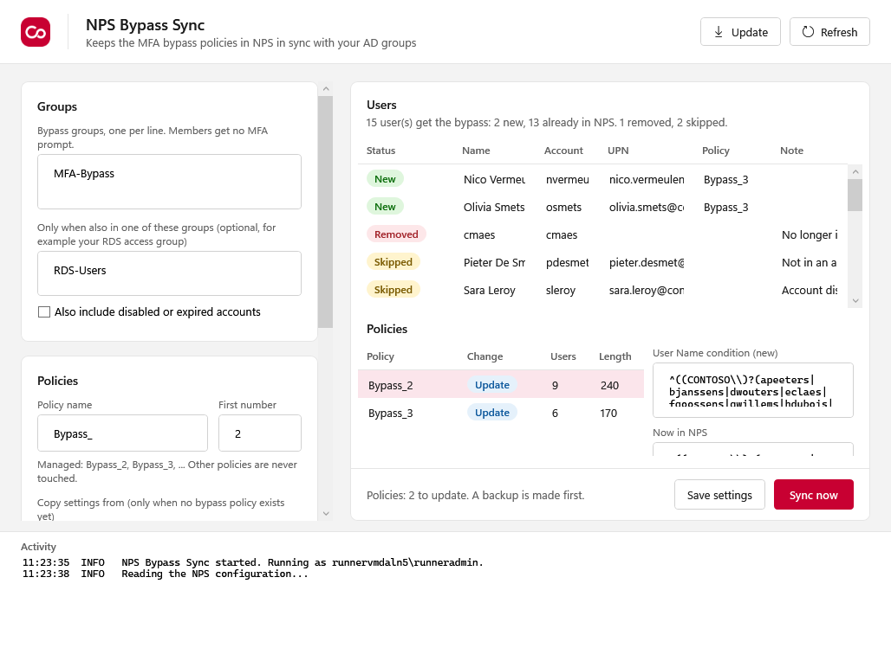

# NPS Bypass Sync

Keeps the MFA bypass policies on your RD Gateway in sync with an AD group.

With the NPS extension for Microsoft Entra MFA, every RD Gateway login gets an Authenticator prompt. A bypass is a connection request policy that handles some users locally, but those policies can't check groups. You end up typing user names into the User Name condition of Bypass_2, Bypass_3 and so on, and splitting them up because the NPS console stops at 256 characters.

This tool does that for you. Put users in the bypass group, and the policies follow.



## Use it

1. Download `NpsBypassSync.exe` from [Releases](../../releases/latest).
2. Run it on the RD Gateway server (the one with NPS). Allow admin rights.
3. Fill in the bypass group. Optionally your RDS access group: then only users in both get the bypass.
4. Click **Save settings** and check the preview: who is new, who is removed, which policies change.
5. Click **Sync now**.
6. Turn on **Automatic sync** so it keeps up by itself.

## What it changes

- Only policies named `Bypass_2`, `Bypass_3`, ... (name and first number can be changed). `Bypass_Admins_Local` and every other policy stay as they are.
- It fills those policies with the users of the group and creates or removes policies when the list grows or shrinks. Each list stays under 250 characters, so you can still open them in the NPS console.
- New policies copy their settings (conditions, Authenticate on this server, source) from the first bypass policy.
- The bypass block keeps its place in the processing order, above the policy that sends everyone else to MFA.
- When the group is empty, one policy stays, switched off.

A user can log on as `DOMAIN\user`, `user` or `user@domain.com`. All three are matched exactly, so `jdoe` never matches `jdoe2`. NPS compares case-insensitively.

## Safety

- NPS is only written when something changed. Before that a backup of the full NPS configuration is saved.
- After writing, the tool reads NPS back and compares. If it doesn't match, the backup goes back in.
- Max users (default 100): when the groups suddenly hold more, nothing is changed. That catches someone nesting Domain Users in the bypass group.
- Disabled and expired accounts are left out.
- If AD can't be read, nothing is changed.
- Changes and errors are written to the Application event log, source `NPS Bypass Sync` (1001 changed, 1003 error).

## Automatic sync

**Turn on** copies the exe to `C:\Program Files\NPS Bypass Sync` and adds the scheduled task `NPS Bypass Sync`. It runs as SYSTEM every 15 minutes (5 to 60) and at startup.

Settings, state, logs and backups are in `C:\ProgramData\NpsBypassSync`. Only SYSTEM and Administrators can open that folder, because NPS backups contain the RADIUS shared secrets.

Command line:

```
NpsBypassSync.exe -Preview
NpsBypassSync.exe -Sync
NpsBypassSync.exe -EnableAutoSync -IntervalMinutes 15
NpsBypassSync.exe -DisableAutoSync
```

## Notes

- Group members are read with a nested search, so groups in groups work and there is no 5000 member limit.
- Users from other domains in the forest are not picked up.
- Two RD Gateways? Run it on each one.
- **Update** checks GitHub for a new version. It also updates the copy that the automatic sync uses.

## Build

```
pwsh build/Build.ps1
```

Needs PowerShell 7 and the .NET 8 SDK. Output: `dist/NpsBypassSync.exe`.

The CI build installs NPS on a Windows Server runner, syncs with test users and checks with real RADIUS requests who skips MFA and who doesn't.

## License

MIT.
